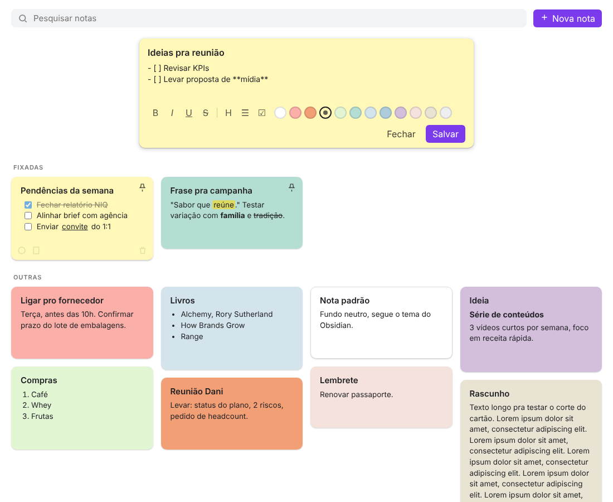

# Keep Notes para Obsidian

Notas rápidas com a cara do Google Keep dentro do Obsidian: grade de post-its coloridos,
botão **Nova nota**, pasta fixa para tudo que você cria e barra de formatação
(negrito, itálico, sublinhado, tachado, destaque, título, tópicos, numerada, tarefa, código).

Cada nota é um arquivo `.md` comum. A cor e o estado "fixada" ficam no frontmatter
(`color` e `pinned`), então nada depende do plugin para continuar legível.

## Instalação manual

1. Na pasta do seu cofre, crie `.obsidian/plugins/keep-notes/`.
2. Copie para lá os três arquivos: `manifest.json`, `main.js` e `styles.css`.
3. No Obsidian: **Configurações → Plugins da comunidade** → desative o modo restrito, se preciso,
   e ative **Keep Notes**.

Sem build, sem `npm`: o plugin é JavaScript puro.

## Uso

| Ação | Como |
| --- | --- |
| Abrir a grade | Ícone de post-it na barra lateral, ou comando **Abrir notas rápidas** |
| Nova nota | Botão **Nova nota**, ícone de "arquivo +" na barra lateral, ou comando **Nova nota rápida** |
| Nota rápida sem abrir modal | Clique em **Criar uma nota...** no topo da grade, escreva e **Salvar** (ou `Ctrl+Enter`) |
| Editar | Clique no cartão |
| Mudar a cor | Ícone de paleta no rodapé do cartão, ou no modal |
| Fixar | Alfinete no canto do cartão |
| Marcar tarefa | Clique na caixa direto no cartão |
| Excluir | Lixeira, dois cliques (vai para a lixeira do sistema) |
| Abrir como nota normal | Ícone de documento no rodapé do cartão |

Atalhos no editor: `Ctrl+B` negrito, `Ctrl+I` itálico, `Ctrl+U` sublinhado,
`Ctrl+Shift+X` tachado, `Ctrl+Shift+C` tarefa, `Ctrl+Shift+8` tópicos, `Ctrl+Enter` concluir.
`Enter` dentro de uma lista continua a lista; `Enter` em item vazio encerra.

## Configurações

- **Pasta das notas**: padrão `Notas rápidas`. Criada automaticamente.
- **Cor padrão** das notas novas.
- **Incluir subpastas** da pasta das notas na grade.
- **Largura dos cartões**.

## Cores

Padrão, Coral, Pêssego, Areia, Menta, Sálvia, Névoa, Céu, Tempestade, Rosa, Giz e Cinza,
com variantes para o tema escuro.
